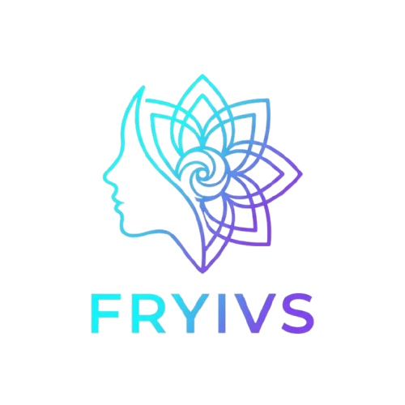
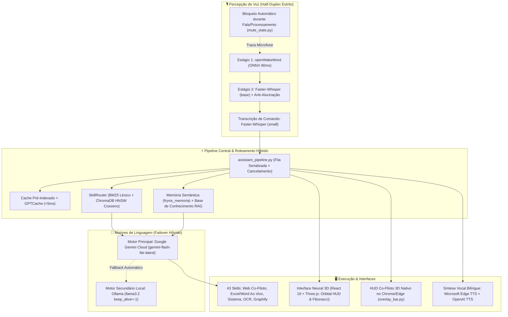

<p align="center">
  
</p>

<h1 align="center">F.R.Y.I.Vs — Sistema Fronteira de Inteligência Virtual</h1>

<p align="center">
  <strong>Assistente Executiva Neural Multi-IA com Controle Autônomo de Desktop, Modo Co-Piloto Web 3D, Automação Microsoft Office ao Vivo e Escuta Contínua em 2 Estágios.</strong>
</p>

---

## 🏢 Proposta de Valor para Empresas

> *"Para empresas, posso ser implementada como uma forma de aumentar a eficiência de novos funcionários, posso aprender com a sua empresa e aumentar a produtividade de comunicação, senhor."*

A **F.R.Y.I.Vs** (pronuncia-se *Frayvis*) combina raciocínio em nuvem (**Google Gemini Flash**) e inferência local (**Ollama `llama3.2`**) com memória semântica de longo prazo (**ChromaDB HNSW**), base de conhecimento corporativa (**RAG**) e execução determinística de **43 ferramentas (Skills)** sobre o sistema operacional Windows, navegadores (**Chrome / Edge**) e suíte **Microsoft Office (Excel e Word)**.

---

## 🧠 Arquitetura Multi-IA Conectada



---

## ✨ Principais Contribuições e Funcionalidades

### 1. 🌐 Modo Co-Piloto Web 3D no Chrome e Edge (`skills/web_automation.py` & `ui/overlay_bar.py`)
- **HUD 3D Exclusivo Fora da Interface da IA:** Quando a F.R.Y.I.Vs realiza pesquisas ou navega no **Google Chrome** ou **Microsoft Edge**, uma barra **HUD 3D WebGL** (`WS_EX_TRANSPARENT | WS_EX_NOACTIVATE`, 100% *click-through*) aparece no topo do navegador sem bloquear cliques, mantendo a tela principal da IA totalmente limpa.
- **Continuidade Entre Chat e Navegador:** Pesquisas feitas inicialmente no chat (`pesquisar_informacao_web`) preservam os links reais; ao pedir *"Muito bem, acesse esse link do Python no Chrome"* ou *"abra o primeiro link"*, a assistente abre e maximiza o site exato em primeiro plano via Selenium.
- **Controle Completo da Aba Ativa:** Clicar em resultados ordinais (*"primeiro link"*, *"segundo resultado"*), rolar página, voltar/avançar, preencher formulários, ler conteúdo da página e tirar capturas.

### 2. 📊 Automação Microsoft Office em Tempo Real (`skills/office_live.py` & `skills/file_data_ops.py`)
- **Microsoft Excel Ao Vivo (`.xlsx`):** Criação, abertura e edição em tempo real via automação COM (`win32com`) + `openpyxl`/`pandas` (adicionar/remover linhas e colunas, atualizar células, calcular totais e filtrar dados com a janela do Excel visível na tela).
- **Microsoft Word Ao Vivo (`.docx`):** Criação de relatórios estruturados, inserção de parágrafos e seções, substituição de trechos e leitura integral de documentos.
- **Memória de Artefato Ativo (`core/session_state.py`):** Permite comandos contínuos (*"adicione uma linha com..."*, *"remova a segunda linha"*) sem precisar repetir o nome da planilha ou documento.

### 3. 🎙️ Escuta Contínua Inteligente e Bloqueio Anti-Eco (`core/voice_daemon.py` & `core/mute_state.py`)
- **Duplo Estágio de Wake Word (`"FRYIVS / Fraives / Frives"`):** Combina detecção neural contínua (`openWakeWord` ONNX) com confirmação fonética e filtro anti-alucinação (`eh_alucinacao_whisper`).
- **Half-Duplex Estrito:** Enquanto a F.R.Y.I.Vs está **processando (`thinking`)** ou **falando (`speaking`)**, a escuta do microfone e o botão de voz ficam **100% desabilitados**, impedindo auto-escuta ou loops de repetição.
- **Resposta Visual Instantânea:** Nos comandos por voz, o balão de texto é transmitido via WebSocket para a interface no exato instante em que a síntese de voz começa, eliminando atrasos visuais.

### 4. 🔮 Interface Neural 3D & Perfis de Velocidade (`ui/react-app/`)
- **Orbe Holográfico Three.js Intercambiável:** Dois motores visuais em tempo real (`Orbital HUD` com anéis segmentados e `Neural Fibonacci` com shaders GLSL e *UnrealBloomPass*) sincronizados com a frequência da voz.
- **3 Perfis de Resposta Selecionáveis em Tempo Real:**
  - `Fryvis Beta` (**40 tokens** — ultra-rápido e telegráfico)
  - `Fryvis 1.0` (**50 tokens** — equilibrado em 1 a 2 frases)
  - `Fryvis Recursive 1.1` (**80 tokens** — raciocínio expandido)
- **Seletor de Motor na UI:** Alternância ao vivo entre **Google Gemini Cloud**, **Híbrido** e **Ollama Local (`llama3.2`)**.

### 5. 🗺️ Introspecção Arquitetural com Graphify (`skills/code_graph_ops.py`)
- Possui um grafo de conhecimento `NetworkX` (`graphify-out/graph.json`) de toda a própria base de código, respondendo sobre onde funções, classes e módulos estão definidos e como se conectam.

---

## 📁 Estrutura Organizada do Projeto

```text
F.R.Y.I.Vs/
├── core/                        # Núcleo de IA, Voz, Memória Vetorial e Orquestração
│   ├── assistant_pipeline.py    # Pipeline unificado (Chat + Voz + TTS + WebSocket)
│   ├── gemini_client.py         # Cliente Google AI Studio (Gemini Flash + Failover)
│   ├── llm.py                   # Orquestrador Multi-LLM, Fast-Paths e Perfis de Tokens
│   ├── skill_router.py          # Roteador Híbrido de Skills (BM25 + ChromaDB HNSW)
│   ├── voice_daemon.py          # Daemon de Wake Word e Máquina de Estados de Voz
│   ├── mute_state.py            # Controle de bloqueio de escuta durante fala/processamento
│   ├── stt.py                   # Faster-Whisper STT + Filtro Anti-Alucinação
│   ├── tts.py                   # Síntese de Voz (Edge TTS Bilíngue / OpenAI / VoiceStudio)
│   ├── memory.py                # Memória Semântica Vetorial (ChromaDB)
│   ├── knowledge_base.py        # Indexador e Buscador RAG da Base de Conhecimento
│   ├── respostas_cache.py       # Cache Semântico Instantâneo (<5ms)
│   ├── session_state.py         # Histórico Unificado e Artefatos Ativos (Web/Excel/Word)
│   └── overlay.py               # Controlador de Estado do HUD Co-Piloto
├── skills/                      # 43 Ferramentas Executáveis (Function Calling)
│   ├── web_automation.py        # Automação Web Co-Piloto (Selenium Chrome/Edge)
│   ├── office_live.py           # Automação ao Vivo de Excel e Word via Win32COM
│   ├── file_data_ops.py         # Operações em Planilhas (.xlsx/.csv), Word (.docx) e Arquivos
│   ├── system_controls.py       # Janelas, Volume, Atalhos, Screenshots e Pesquisa Rápida
│   ├── open_app.py              # Descoberta e Abertura Inteligente de Aplicativos Windows
│   ├── visual_ocr.py            # Visão Computacional (OpenCV) e OCR de Tela (PyTesseract)
│   ├── scheduler_ops.py         # Agendamento de Tarefas e Alertas via Webhook
│   └── code_graph_ops.py        # Consulta ao Grafo Arquitetural do Código (Graphify)
├── ui/                          # Frontend React 19 + Three.js e HUD 3D Nativo
│   ├── index.html               # Entrypoint Web servido pelo FastAPI
│   ├── overlay_bar.py           # HUD 3D Co-Piloto Flutuante para Chrome/Edge
│   ├── assets/copiloto_3d_frames/ # Quadros 3D WebGL do HUD Co-Piloto
│   └── react-app/               # Código-fonte TypeScript/React + Shaders GLSL do Orbe
├── data/                        # Caches pré-indexados, manifestos RAG e estado do HUD
├── docs/                        # Documentação técnica, guias de teste e ativos visuais
├── scripts/                     # Scripts utilitários (geração de embeddings e treinamento)
├── tests/                       # Suíte com 495 testes automatizados (Pytest)
├── server.py                    # Servidor Principal FastAPI + WebSocket (Porta 8000)
├── main.py                      # Modo Terminal Interativo (CLI)
└── iniciar_fryivs.bat           # Inicializador rápido para Windows
```

---

## 🚀 Como Instalar e Executar

### 1. Configurar o Ambiente Virtual e Dependências
```powershell
python -m venv venv
.\venv\Scripts\activate
pip install -r requirements.txt
```

### 2. Configurar o Arquivo `.env`
Copie o modelo `.env.example` para `.env` e preencha sua chave do Google AI Studio (`GEMINI_API_KEY`):
```powershell
copy .env.example .env
```

### 3. Iniciar o Servidor e a Interface Neural (Recomendado)
```powershell
.\venv\Scripts\python.exe -B server.py
```
Acesse no navegador: **[http://127.0.0.1:8000](http://127.0.0.1:8000)**

### 4. Executar a Suíte de Testes Automatizados
```powershell
.\venv\Scripts\python.exe -B -m pytest tests/ -q
```
